# ROS LLM Ops

[](https://github.com/ApurvK032/ros-llm-ops/actions/workflows/ci.yml) [](LICENSE)     

**A warehouse robot you can talk to, and an on-call agent that repairs it when something breaks.**

ROS LLM Ops is a mission supervisor for a ROS 2 warehouse robot, with a recovery layer that watches it work. A local language model turns operator requests into typed commands; the supervisor validates them against the robot's current state, sequences the pickups and drops, and drives a TurtleBot3 through Nav2. When a fault hits (a crashed Nav2 server, a dead lidar, a lost pose, a bad parameter, a blocked station), a recovery agent pauses the mission, works out what went wrong from live ROS data, and repairs it through a gate that only lets through actions the evidence supports.

**Stack:** ROS 2 Jazzy · Nav2 · Gazebo Harmonic · Python · Ollama / Qwen3.5 (local, no API key)

<picture>
  <source media="(prefers-color-scheme: dark)" srcset="docs/figures/replay-controller_crash-dark.gif">
  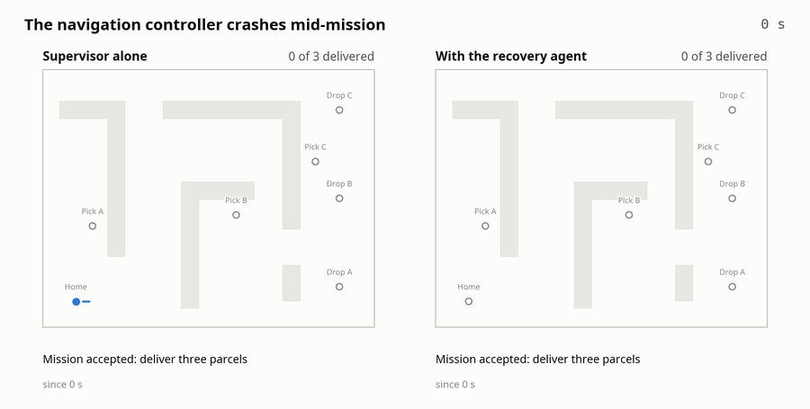
</picture>

*Two recorded runs of the same mission, replayed from their data. The Nav2 controller is killed 19 s in. Left: the supervisor alone gives up with nothing delivered. Right: the recovery agent restarts the controller and the mission finishes.*

[At a glance](#at-a-glance) · [When something breaks](#when-something-breaks) · [How recovery works](#how-recovery-works) · [Quick start](#quick-start) · [Example missions](#example-missions) · [How it works](#how-it-works) · [Roadmap](#roadmap) · [Evaluation](docs/evaluation.md) · [Design](docs/design.md)

## At a glance

| | |
| --- | --- |
| Simulated missions in the [evaluation](docs/evaluation.md) | **234**, over 13 scenarios: ten faults and three cases with nothing to fix |
| Missions that end as they should, supervisor alone | **12 of 39** |
| The same with the recovery agent attached | **50 to 55 of 65**, depending on who decides |
| Pickups and deliveries checked against the simulator's true pose | **1,068**; every one made with the agent attached was confirmed |
| Mission journals that pass the independent checker | **266 of 266** |
| Tests that need no ROS, GPU or model | **199**, and 11 of 11 planted bugs caught |

## When something breaks

<picture>
  <source media="(prefers-color-scheme: dark)" srcset="docs/figures/batch-success-dark.png">
  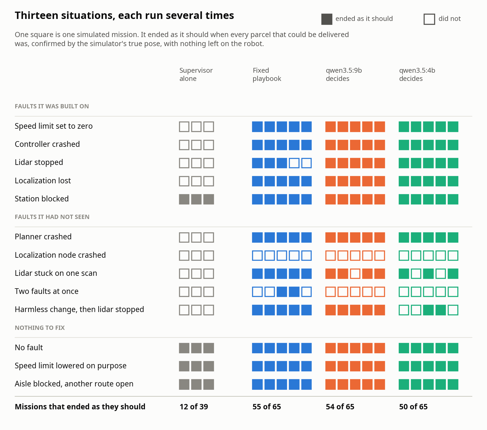
</picture>

Thirteen situations, each run several times in simulation: ten faults, and three cases where nothing needs
fixing. 234 missions in all, written up in the [evaluation](docs/evaluation.md).

- **Alone, the supervisor gets 12 of 39 missions right**, nine of them the ones where nothing was wrong. It never breaks one of its own rules, but it retries without a pause, so a crash or a dead lidar ends the mission within two seconds.
- **With the recovery agent, 50 to 55 of 65**, depending on who decides; 73 of 75 on the five faults it was built on. A recovered mission takes 4 to 25 s longer than a fault-free one.
- **Every action passes a gate.** A parameter is restored only if it was seen to change, a process restarted only if it was seen dead, a parcel skipped only if something stands where it must go. No action takes a free-form value from a model.
- **A fixed playbook does as well as a local model, and sooner.** `qwen3.5:9b` and `qwen3.5:4b` choose from the same actions over the same evidence. They resumed 4 to 15 s later and did no better.
- **Deliveries are checked against the simulator's true pose.** Every one made with the agent attached was where the journal says. With the lidar frozen and nobody attached, the supervisor reported deliveries with the robot 9 to 20 m away.
- **What it cannot do yet is measured too.** A localization node that restarts in the wrong place is not recovered (0 of 15), two faults at once rarely (2 of 15), and a speed limit lowered on purpose is always put back. All 36 failures trace to three causes in the layer the decision-makers share; the evaluation names them.

<picture>
  <source media="(prefers-color-scheme: dark)" srcset="docs/figures/replay-lidar_frozen-dark.gif">
  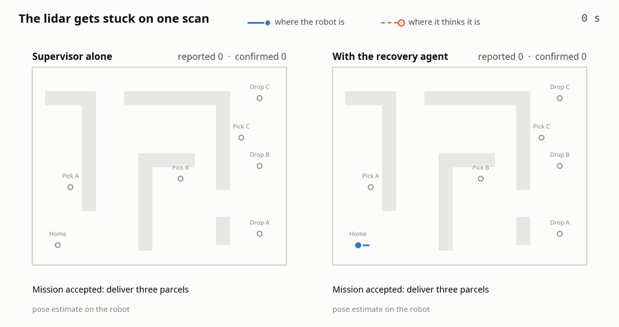
</picture>

*Why deliveries are checked against the true pose. The lidar gets stuck on one scan. Left: with nobody watching, the robot's own estimate (dashed) drives on to every station and the mission is reported complete, while the robot (solid) ends up against the west wall, almost 19 m away. Right: the agent restarts the lidar driver, the mission resumes 13 s after the fault, and all three deliveries are real.*

<picture>
  <source media="(prefers-color-scheme: dark)" srcset="docs/figures/replay-blocked_station-dark.gif">
  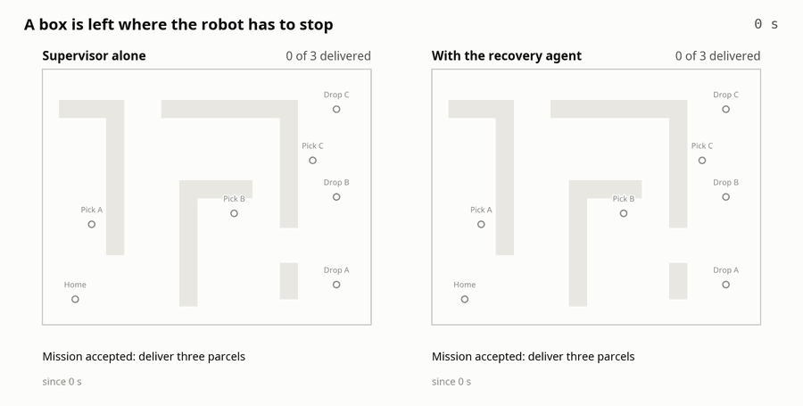
</picture>

*A fault the robot cannot fix. A box is left where it must stop. Both runs deliver two of three; the agent's is done in 104 s, the supervisor's in 462 s.*

### How recovery works

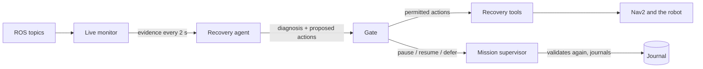

1. **Watch.** A monitor turns the live ROS topics into evidence: heartbeats, scan rate, commanded against measured speed, pose jumps, parameter changes, new obstacles.
2. **Pause and diagnose.** When something looks wrong the mission is held first. Eight read-only checks say what was seen; the fixed rules or a local model say what it means.
3. **Decide.** The playbook or the model picks from six typed actions: restore a parameter, restart a process, relocalize, clear the costmaps, give up on a parcel, call a person.
4. **Gate.** Each action runs only if the evidence backs it, whoever proposed it. The model can choose which action and which target; it cannot choose a value.
5. **Act and resume.** The supervisor checks every mission command again and journals it, and an independent checker replays the journal afterwards.

| What a recovery costs | Diagnosing a recording |
| --- | --- |
| <picture><source media="(prefers-color-scheme: dark)" srcset="docs/figures/batch-time-dark.png">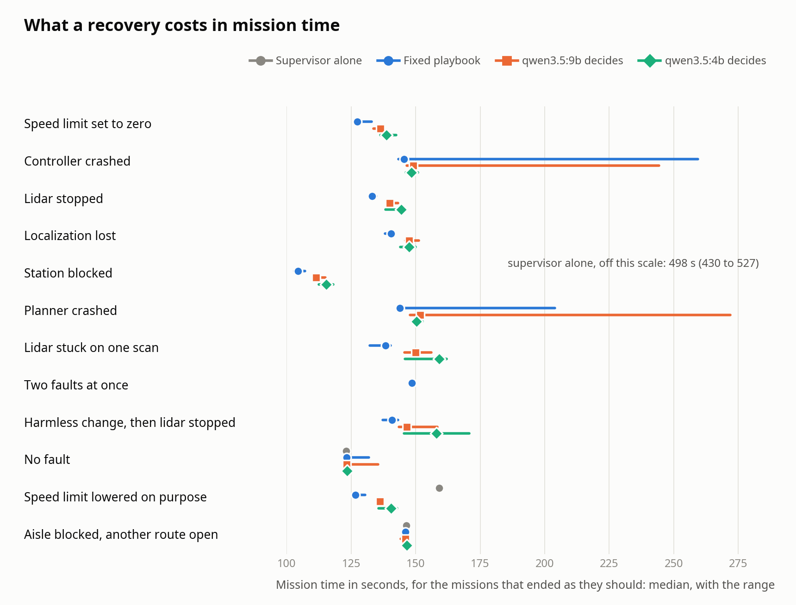</picture> | <picture><source media="(prefers-color-scheme: dark)" srcset="docs/figures/diagnosis-scoreboard-dark.png">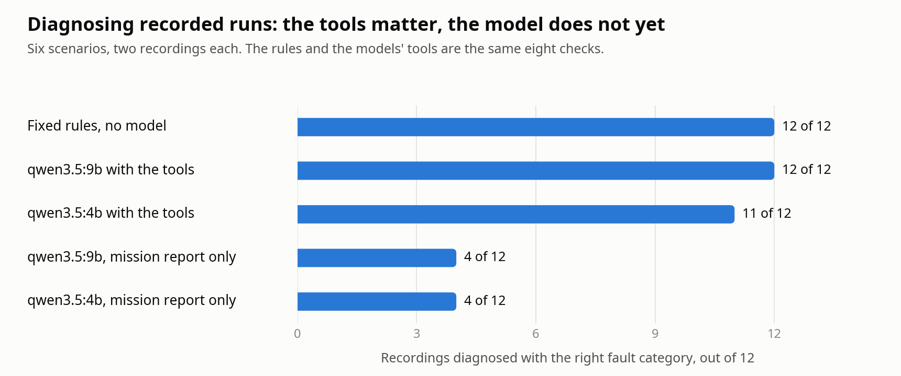</picture> |
| A recovered mission takes 4 to 25 s longer than a fault-free one with the playbook, 13 to 36 s with a model ([evaluation](docs/evaluation.md#what-a-recovery-costs)). | With the checks as tools, the models name the fault in 11 and 12 of 12 recordings; from the mission report alone, 4 of 12 ([diagnosis](docs/diagnosis.md)). |

| | |
| --- | --- |
| [Fault-injection scenarios](docs/scenarios.md) | The thirteen scenarios, how faults are injected, how deliveries are checked against the true pose, and what the supervisor does alone |
| [Diagnosis](docs/diagnosis.md) | Read-only checks over recorded evidence, a model that uses them as tools, and a scoreboard |
| [Recovery](docs/recovery.md) | The live monitor, the gate, the actions, and what went wrong on the way |
| [Evaluation](docs/evaluation.md) | 234 missions: rates by decision-maker, the three causes behind every failure, what the gate refused, what a recovery costs |
| [MCP server](docs/mcp.md) | The same checks as read-only tools for any Model Context Protocol client |

```bash
python3 -B -m warehouse_agent scenario scenarios/controller_crash.json                    # the fault, supervisor alone
python3 -B -m warehouse_agent scenario scenarios/controller_crash.json --recover rules    # with the playbook
python3 -B -m warehouse_agent scenario scenarios/controller_crash.json --recover qwen3.5:9b
python3 -B -m warehouse_agent diagnose docs/evidence/scenarios/*/* --rules                # needs no ROS or model
python3 -B -m warehouse_agent batch-report docs/evidence/batch                            # the table above, from the results
python3 -B -m warehouse_agent.mcp_server docs/evidence/scenarios                          # the checks, over MCP
```

## What it does

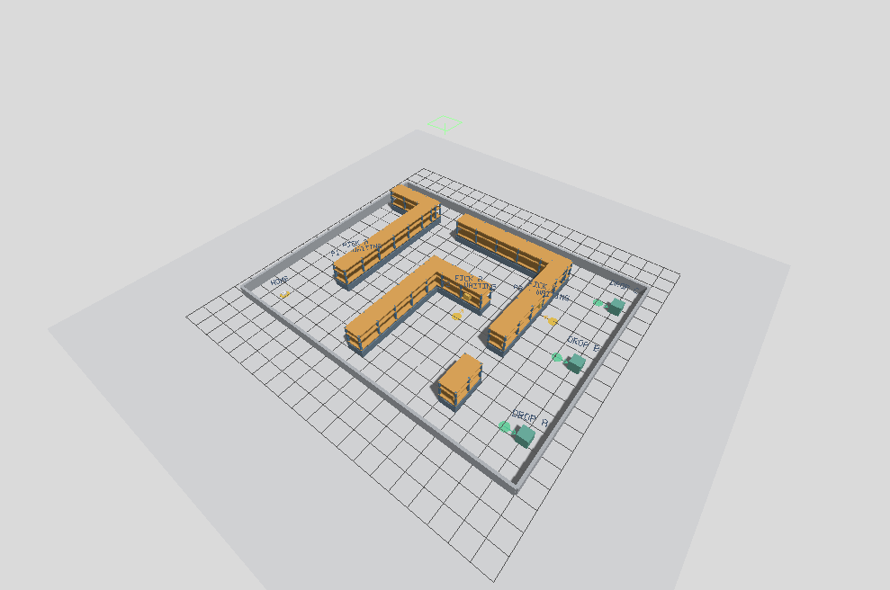

*The 18 × 14 m Gazebo warehouse, ready for a mission. Parcels wait on the shelves; ground circles mark where the robot must stop and face them.*

- **Natural-language missions, locally.** Qwen3.5 4B runs through Ollama with schema-constrained output. The model only proposes one typed intent; it never sees coordinates, moves the robot, or reports outcomes.
- **Changes while the robot is moving.** Prioritize a parcel, deliver onboard cargo first, cancel an uncollected order, pause, resume, or ask what the robot is carrying.
- **State that stays correct.** A cancel waits for Nav2 to confirm the goal has ended before anything new is dispatched; cargo is frozen while the model is thinking; an onboard parcel is never silently dropped from the mission.
- **Verified transfers.** Pickup and drop require Nav2 success plus measured position, heading, facing, and clearance checks. A failed stop gets one retry, then is deferred with the measured reason.
- **Planning over live state.** Remaining stops are rebuilt at every action boundary and ordered greedily with A* travel-cost estimates, honoring pickup-before-drop, priority, and onboard-first.
- **One geometry source.** A single config generates the Gazebo world, the Nav2 map, the planning grid, and the spawn pose.
- **Checked, not just tested.** An independent checker rebuilds any run from its journal and verifies every safety rule; all recorded Gazebo runs pass. Property-based tests drive the supervisor through hundreds of random sessions, and planted bugs are caught.
- **Observable.** Live RViz and Gazebo markers, a mission panel, a browser desktop over SSH, and a JSONL journal of every request, plan, navigation result, and cargo change.

Pickup and drop are logical state changes; there is no arm or grasping.

## How it works

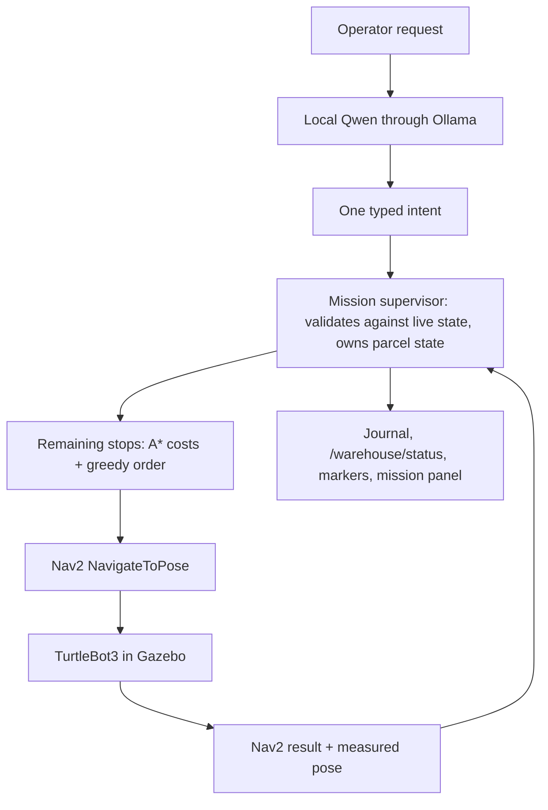

The model decides **what the operator wants**; the supervisor decides **what is allowed and what happens next**; Nav2 handles motion. Direct controls such as `/pause` bypass the model entirely. The [design doc](docs/design.md) covers the parcel state model, request rules, timing rules, planning, and known limitations.

### The warehouse

| Parcel | Pickup | Drop |
| --- | --- | --- |
| P1 | `PICK_A` | `DROP_A` |
| P2 | `PICK_B` | `DROP_B` |
| P3 | `PICK_C` | `DROP_C` |

Seven rack sections form aisles and L-shaped corners across 18 × 14 m. The robot starts at `HOME` and must stop 1.0 m in front of each parcel, facing it, before a transfer counts. Geometry, stations, and tolerances live in [config/warehouse.json](config/warehouse.json); edit it and restart the simulator to regenerate everything.

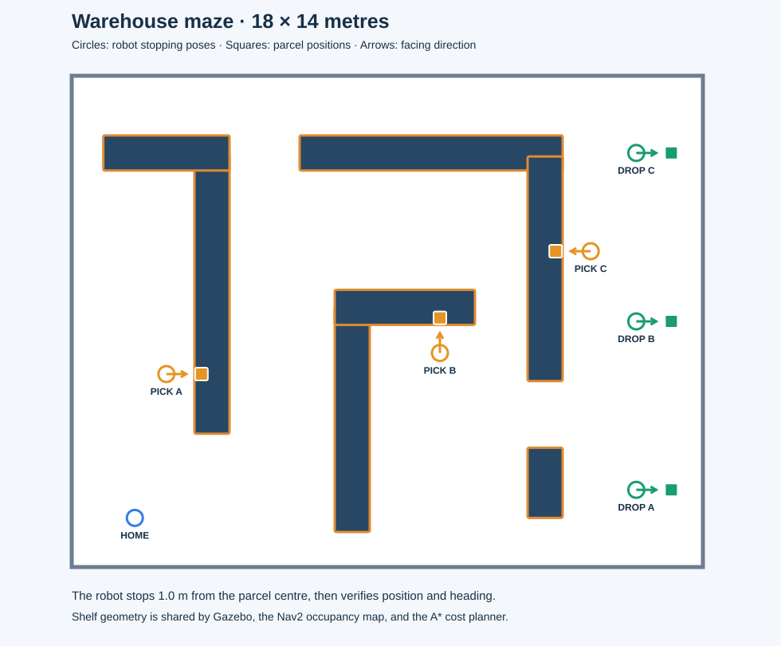

See the [warehouse layout guide](docs/warehouse-layout.md) for the floor plan and transfer checks.

## Quick start

### 1. Clone and run the tests

Use **Python 3.12+**. No ROS, GPU, model, or extra packages are needed.

```bash
git clone https://github.com/ApurvK032/ros-llm-ops.git
cd ros-llm-ops
python3 -B -m unittest discover -s tests -v
python3 -B -m warehouse_agent doctor
```

`doctor` reports what it observes about your environment; it installs nothing. With `pip install hypothesis`, the same test command also runs the property-based tests. To check any mission journal against the supervisor's rules:

```bash
python3 -B -m warehouse_agent verify docs/evidence/maze/delivery.jsonl
```

### 2. Prepare the simulation environment

The simulation runs on **Ubuntu 24.04** with ROS 2 Jazzy, Gazebo Harmonic, and Ollama (tested on WSL2 with Ollama 0.33.3). The installer configures the official ROS package source and installs Jazzy, Nav2, the TurtleBot3 simulation, Gazebo integration, Qt, and build tools; it refuses other Ubuntu versions.

```bash
# Preview the installer, then apply it inside Ubuntu 24.04.
bash scripts/install_ros_jazzy.sh
bash scripts/install_ros_jazzy.sh --apply
```

Install Ollama using its [official Linux instructions](https://docs.ollama.com/linux). The launcher starts Ollama if needed and downloads [qwen3.5:4b](https://ollama.com/library/qwen3.5:4b) on first use; after that, inference runs locally. Use Ubuntu 24.04's system `python3` so the apt-installed ROS packages are importable.

### 3. Launch and give it a mission

With no other warehouse demo running:

```bash
bash scripts/demo.sh
```

Wait for `Nav2 and localization ready`, then type into the **agent terminal**:

```text
Deliver all three parcels
```

Gazebo, RViz, and the mission panel open. Parcels change from **amber → blue → green** as they go from waiting to onboard to delivered. A cold model load can take about a minute.

For a single mission that exits when it finishes:

```bash
bash scripts/demo.sh --command 'Deliver all three parcels'
```

<details>
<summary>Two-distribution WSL setup</summary>

If your source checkout and ROS runtime live in different WSL distributions, the wrapper syncs sources into the runtime copy before launching:

```bash
bash scripts/wsl.sh demo
bash scripts/wsl.sh demo --command 'Deliver all three parcels'
bash scripts/wsl.sh logs
```

It defaults to the `Ubuntu-24.04` distribution, your current username, and `~/ros-llm-ops` in the runtime; see the [environment guide](docs/environment.md#wsl-wrapper-configuration) to override them.

</details>

## Example missions

Enter one instruction at a time and wait for it to be interpreted before sending the next.

| Instruction | When | Expected behavior |
| --- | --- | --- |
| `Deliver all three parcels` | Fresh mission | Schedule P1, P2, and P3, pickup before drop |
| `Deliver P1 and P2` | Fresh mission | Schedule only those two |
| `Make P3 the highest priority` | P3 active and unfinished | Serve P3's remaining stops first |
| `Deliver the parcels already onboard first` | Robot carrying cargo | Drop current cargo before any new pickup |
| `Cancel order P2` | P2 active and still on its shelf | Cancel P2 once any navigation cancel is confirmed |
| `What are you carrying?` | Any time | Show the supervisor's state, not the model's opinion |
| `Deliver P9` | Any time | Ask for clarification; P9 does not exist |

| Direct command | Behavior |
| --- | --- |
| `/status` | Print the current mission state |
| `/pause` | Stop the robot (Nav2 cancel) and hold the mission |
| `/resume` | Continue the remaining work |
| `/quit` | Stop the agent; the combined launcher also stops the simulation |

**Try a live update:** start all three deliveries, enter `/pause`, enter `Make P3 the highest priority`, then `/resume`. The new stop order appears when execution resumes. Cancelling a parcel that is already **onboard** pauses and asks what to do; `/resume` continues its original delivery.

Full walkthroughs with expected observations: [examples/missions.md](examples/missions.md).

## Watch and control it in a browser

The real Gazebo, RViz, mission panel, and terminal can run on a private virtual desktop, streamed with noVNC through an SSH tunnel. After setup steps 1–2:

```bash
bash scripts/install_browser.sh --apply
ollama pull qwen3.5:4b   # needs `ollama serve` running; the browser launcher requires the model
bash scripts/run_browser.sh
```

Get the generated password with `bash scripts/run_browser.sh info`, forward the port from your own computer with `ssh -N -L 6080:127.0.0.1:6080 YOUR_SSH_HOST`, and open [the browser desktop](http://localhost:6080/vnc.html?autoconnect=1&resize=scale&reconnect=1). The gateway binds to loopback only. Details and troubleshooting: [browser access guide](docs/browser-access.md).

## Results

Fault, diagnosis and recovery results are under [When something breaks](#when-something-breaks). This section is the fault-free mission.

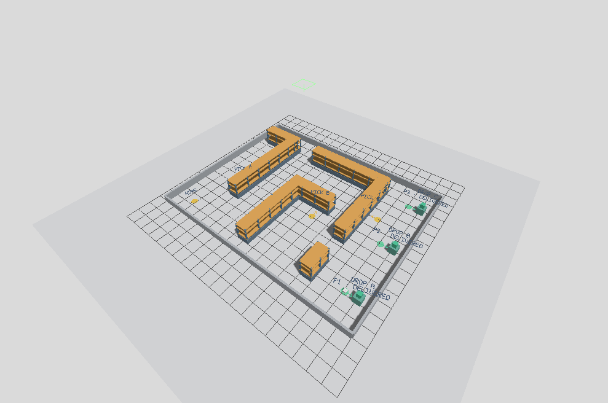

In the current maze, `Deliver all three parcels` completed 3 pickups and 3 drops with all six Nav2 goals succeeding, **123.0 s** after the intent was accepted. An independent observer compared every transfer with Gazebo's ground-truth robot pose:

| Check at transfer (ground truth) | Worst case | Limit |
| --- | --- | --- |
| Distance from the approach pose | 0.132 m | 0.20 m |
| Facing error toward the parcel | 10.1° | 14.3° |
| Conservative parcel clearance | 0.422 m | ≥ 0.20 m |

The unit and property-based tests run in CI on every pull request, together with a check that every committed journal still passes the checker and that the published batch tables are what the committed results give. Earlier runs in the original layout covered browser-operated delivery and mid-mission pause, cancel, priority, and onboard-first updates against Nav2. These are single development runs, not a reliability benchmark; see [results](docs/results.md) for every measurement and its evidence.

## Project map

| Path | Responsibility |
| --- | --- |
| [config/warehouse.json](config/warehouse.json) | Geometry, stations, parcels, and tolerances |
| [warehouse_agent/language.py](warehouse_agent/language.py) | Model prompt and intent schema |
| [warehouse_agent/mission.py](warehouse_agent/mission.py) | Authoritative mission state, request rules, execution, and journal |
| [warehouse_agent/state.py](warehouse_agent/state.py) | Parcel, navigation-goal, and hold state machines |
| [warehouse_agent/verify.py](warehouse_agent/verify.py) | Independent journal checker (`warehouse_agent verify`) |
| [warehouse_agent/planner.py](warehouse_agent/planner.py), [astar.py](warehouse_agent/astar.py) | Remaining-stop ordering and travel-cost estimates |
| [warehouse_agent/world.py](warehouse_agent/world.py) | Arrival checks and generated world and maps |
| [warehouse_agent/ros_backend.py](warehouse_agent/ros_backend.py) | Nav2 goals, cancellation, measured pose, and status topic |
| [warehouse_agent/visualization.py](warehouse_agent/visualization.py) | RViz and Gazebo markers and the mission panel |
| [warehouse_agent/cli.py](warehouse_agent/cli.py) | Operator loop and direct controls |
| [warehouse_agent/scenario.py](warehouse_agent/scenario.py), [faults.py](warehouse_agent/faults.py) | Fault-injection scenario runner and the five fault injectors |
| [warehouse_agent/ground_truth.py](warehouse_agent/ground_truth.py) | The robot's true pose from the simulator, and the check of every transfer against it |
| [warehouse_agent/batch.py](warehouse_agent/batch.py) | Repeated runs of every scenario against each decision-maker, judged and summarized |
| [warehouse_agent/evidence.py](warehouse_agent/evidence.py), [monitor.py](warehouse_agent/monitor.py) | Evidence from a recording, and the same evidence live from the topics |
| [warehouse_agent/diagnosis.py](warehouse_agent/diagnosis.py) | Read-only checks, the model that uses them as tools, the rule baseline, and scoring |
| [warehouse_agent/recovery.py](warehouse_agent/recovery.py), [recovery_tools.py](warehouse_agent/recovery_tools.py) | Recovery agent, its gate and playbook, and the ROS-side recovery actions |
| [warehouse_agent/mcp_server.py](warehouse_agent/mcp_server.py) | The diagnostic checks as read-only tools over the Model Context Protocol |
| [scenarios/](scenarios/) | One JSON file per scenario: the mission, the faults, when they land, the ground truth, and what a correct response achieves |
| [ros_ws/src/warehouse_interfaces](ros_ws/src/warehouse_interfaces) | Typed ROS 2 messages, services, and the ApproachAndVerify action |
| [sim/](sim/), [scripts/](scripts/) | Launch configuration, Gazebo marker helper, installers, and launchers |
| [tests/](tests/), [tests_ros/](tests_ros/) | Unit and property-based tests (no ROS required); tests against the built ROS messages |
| [docs/](docs/) | Design, results, guides, figures, and recorded evidence ([scripts/make_figures.py](scripts/make_figures.py) redraws the figures from it) |

## Roadmap

- [x] Local model → supervisor → Nav2 → Gazebo delivery pipeline with verified logical transfers
- [x] Mid-mission pause, resume, cancel, priority, and onboard-first
- [x] Shelf maze with separate approach poses and ground-truth-checked transfers
- [x] Live visualization, mission panel, and browser access
- [x] **Correctness core, part 1:** independent journal checker, property-based tests with a mutation check, and explicit state machines
- [x] **Correctness core, part 2:** request IDs with exactly one recorded outcome each, and journaling the normalized command that was applied
- [x] **Fault injection:** a scenario runner with five fault types, recorded and scored, and the supervisor's behaviour alone as the baseline
- [x] **Diagnosis:** read-only checks over recorded evidence, a local model that uses them as tools, a rule baseline, and a scoreboard
- [x] **Recovery:** fault holds, direct defer and retry commands, a command service, a live monitor, and a recovery agent whose actions pass an evidence gate
- [x] **Harder cases and measured rates:** seven more scenarios, 234 repeated missions, every transfer checked against Gazebo's true pose, and the checks exposed over MCP
- [ ] **What the evaluation found:** judge a dead sensor by what is arriving now, look again before resuming when nothing was found, restore the pose after a localization restart, and tell a harmless parameter change from a harmful one
- [ ] **ROS 2-native packaging:** colcon packages, typed messages and actions, a lifecycle supervisor node, a C++ approach-and-verify action server, and Docker
- [ ] **Richer operations:** orders added mid-mission, robot capacity, multi-part requests, a plan preview before changes commit, and better sequencing
- [ ] Later: multiple robots with task allocation, an operator dashboard, and sensor-based arrival verification

Current limitations are listed in the [design doc](docs/design.md#known-limitations).

## Documentation

- [Design](docs/design.md): architecture, state model, request and timing rules, planning, limitations
- [Scenarios](docs/scenarios.md), [diagnosis](docs/diagnosis.md) and [recovery](docs/recovery.md): fault injection, what the supervisor does alone, diagnosing a run, and repairing one
- [Evaluation](docs/evaluation.md): thirteen scenarios run repeatedly, with rates, failure causes and costs
- [MCP server](docs/mcp.md): the diagnostic checks for any MCP client
- [Results](docs/results.md): every fault-free measurement with its evidence
- [Runbook](docs/runbook.md): operation, separate terminals, troubleshooting
- [Environment](docs/environment.md) and [browser access](docs/browser-access.md): setup guides
- [Warehouse layout](docs/warehouse-layout.md) and [visual guide](docs/visuals.md): floor plan, markers, and panel
- [Archive](docs/archive/README.md): planning documents and the related-work survey from before the build

This project grew out of my earlier [WarehouseBot Pick-and-Drop Optimization](https://github.com/ApurvK032/WarehouseBot-Pick-and-Drop-Optimization); its A* is included unchanged in [warehouse_agent/astar.py](warehouse_agent/astar.py). The [reference audit](docs/reference-audit.md) lists what was reused and adapted. To reproduce that project's offline planner results, run `bash scripts/fetch_reference.sh` and then `python3 -B -m warehouse_agent baseline`.

## License

MIT. See [LICENSE](LICENSE).
