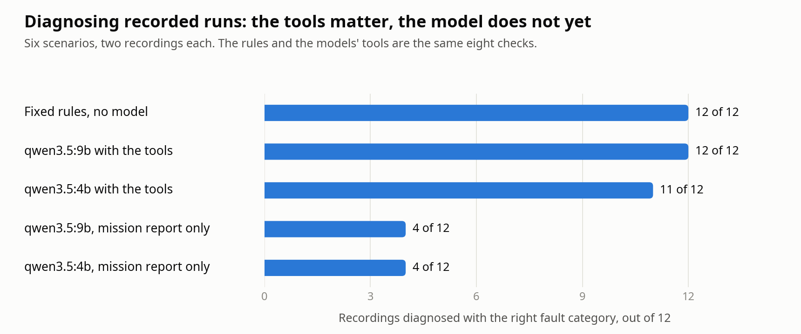

# Diagnosing a run

After a scenario run, `diagnose` works out what went wrong from the recording and is scored against the fault
that was actually injected.

```bash
python3 -B -m warehouse_agent diagnose artifacts/scenarios/lidar_dropout/<time>            # local model, with tools
python3 -B -m warehouse_agent diagnose artifacts/scenarios/lidar_dropout/<time> --no-tools # mission report only
python3 -B -m warehouse_agent diagnose artifacts/scenarios/lidar_dropout/<time> --rules    # fixed rules, no model
python3 -B -m warehouse_agent scoreboard artifacts/scenarios/*/*                            # table of saved results
```

The recordings behind the numbers below are too large to commit, but their extracted evidence is in
[`docs/evidence/scenarios/`](evidence/scenarios/), so the diagnoses can be re-run from a clone with only Ollama:

```bash
python3 -B -m warehouse_agent diagnose docs/evidence/scenarios/*/* --model qwen3.5:9b
```

## How it works

1. **Evidence.** `warehouse_agent.evidence` reads the run's MCAP bag once (this step needs ROS) and writes a compact
   `evidence.json`: Nav2 heartbeats, lidar message rate, commanded and measured speed, pose-estimate jumps and
   resets, runtime parameter changes, obstacles that appeared in the global costmap, planner and controller
   failures, and warnings. Times are seconds from the start of the mission, so they line up with the journal.
2. **Checks.** Eight read-only checks turn that evidence into observations with times, for example
   "scans stopped arriving at about 20.0 s and never resumed". They report what was seen, not what it means.
   `health_report` runs all of them and lists anything unusual.
3. **Diagnosis.** The model gets the mission report and the checks as tools (Ollama tool calling), investigates
   for up to eight steps, then must answer in a fixed JSON shape: one of nine categories, the component at fault,
   a root-cause sentence, the supporting evidence and a confidence.
4. **Score.** The category must match the scenario's ground truth exactly. Naming the specific cause (the node,
   the parameter, the waypoint) is scored separately and only counts when the category is right.

Traces left by the fault injector itself are hidden from the checks: the lidar relay's parameter change and the
raw lidar topic never reach the model, because a real sensor failure leaves no such trace. Signals a real system
would also have are kept, such as `/parameter_events` for a changed Nav2 parameter and `/initialpose` for a pose
reset.

## Results

<picture>
  <source media="(prefers-color-scheme: dark)" srcset="figures/diagnosis-scoreboard-dark.png">
  
</picture>

Twelve recordings: the six scenarios, each recorded twice (see [scenarios](scenarios.md)). One diagnosis per
recording at temperature 0, on an RTX 4070. A cell is correct categories out of recordings; "specific" is how many
of those also named the right node, parameter, sensor or waypoint.

| Scenario | Rules, no model | qwen3.5:4b + tools | qwen3.5:9b + tools | qwen3.5:4b, no tools | qwen3.5:9b, no tools |
| --- | --- | --- | --- | --- | --- |
| nominal (no fault) | 2/2 | 2/2 | 2/2 | 2/2 | 2/2 |
| blocked_station | 2/2 | 2/2 | 2/2 | 2/2 | 2/2 |
| controller_crash | 2/2 | 2/2 | 2/2 | 0/2 | 0/2 |
| lidar_dropout | 2/2 | 2/2 | 2/2 | 0/2 | 0/2 |
| localization_lost | 2/2 | 2/2 | 2/2 | 0/2 | 0/2 |
| bad_parameter | 2/2 | 1/2 | 2/2 | 0/2 | 0/2 |
| **All** | **12/12** (10/10 specific) | **11/12** (9/10 specific) | **12/12** (10/10 specific) | 4/12 | 4/12 |

| Diagnoser | Mean time per diagnosis | Mean tool calls |
| --- | --- | --- |
| qwen3.5:4b + tools | 4.5 s | 1.7 |
| qwen3.5:9b + tools | 6.1 s | 2.2 |

How to read this:

- **The tools are what make diagnosis possible.** With only the mission report, both models get 4 of 12: the
  control runs and `blocked_station`. For the other four faults the 4B model answers "unknown" every time, and
  the 9B model blames an obstacle every time.
- **On these cases the model adds nothing over fixed rules.** A short list of rules over the same checks scores
  12 of 12. Each scenario has one clean fault, and for one clean fault the checks are close to an answer already.
  The model should earn its place on what rules handle badly: unrelated anomalies appearing together, faults no
  rule was written for, and choosing a recovery. Those cases are not in this set yet.
- **The 4B model is the weak link.** Its one miss called a zeroed speed limit an actuator fault while quoting
  the parameter change as evidence. It is also sensitive to wording: with an earlier version of the prompt and
  tool text it scored 8 of 12 on the same evidence. (The 9B model was not run on that version.)

## Limitations

- **This is a development set.** The checks, the prompt and the wording of the tool output were written and
  adjusted while looking at these same twelve recordings. The scores show the approach works on them; they are
  not a held-out measurement.
- Two recordings per scenario, one diagnosis each. Twelve cases cannot separate 11 of 12 from 12 of 12 with any
  confidence.
- One fault per run, always the same mission and warehouse, with the fault always at the same point.
- The diagnosis is made after the run ends, from the whole recording. A live agent would have to decide with
  only what has happened so far.
- Scoring checks the category and that the right component is named. It does not judge whether the root-cause
  sentence is well reasoned.
