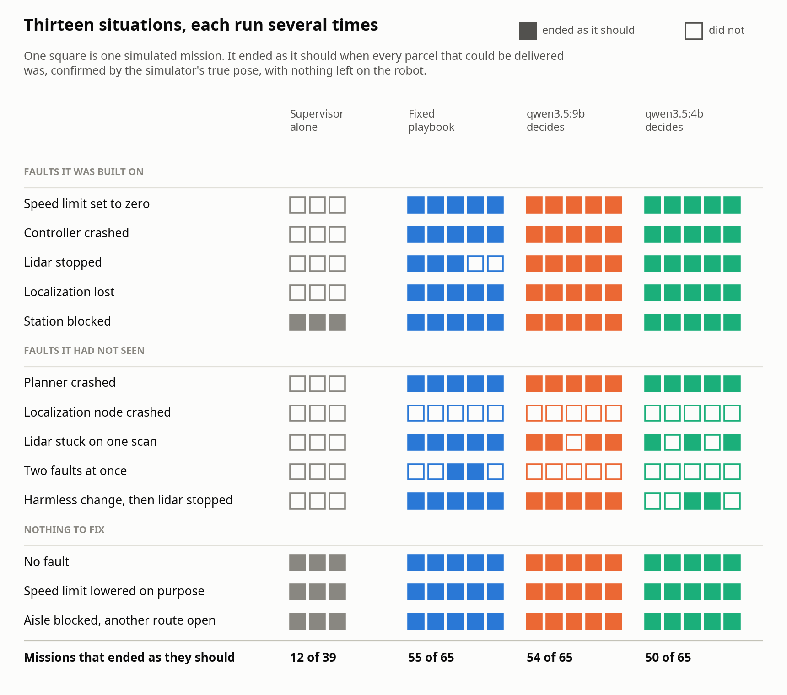
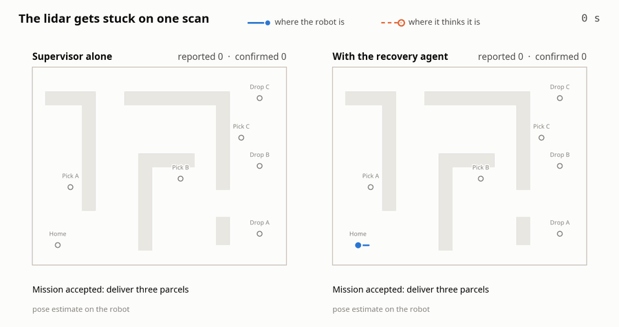
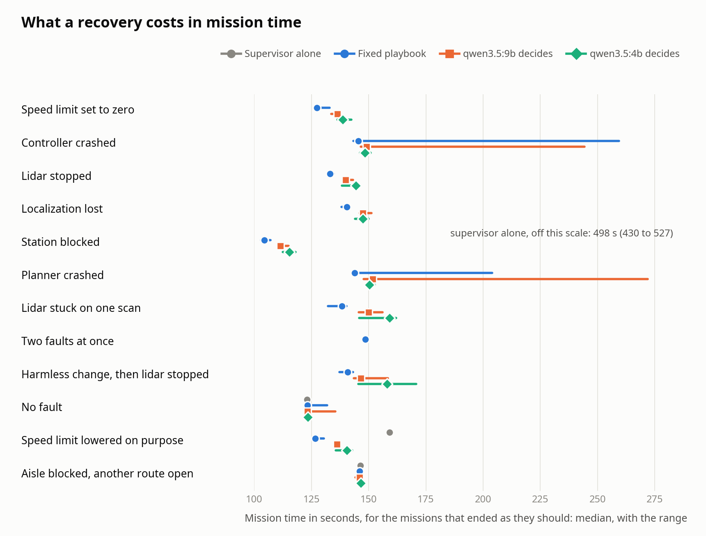

# Evaluation: thirteen scenarios, 234 missions

The [recovery](recovery.md) results are one run of each of the five faults the agent was built on. This page is
what happened when the same agent was run repeatedly: on those five, on five faults written afterwards, and on
three situations in which nothing needs fixing.

<picture>
  <source media="(prefers-color-scheme: dark)" srcset="figures/batch-success-dark.png">
  
</picture>

In short:

- **Alone, the supervisor gets 12 of 39 missions right; with the agent attached it is 50 to 55 of 65.** On the
  five faults the agent was built on, 73 of 75.
- **It carries over to new faults of a kind it knows**, a different crashed server (15 of 15) and a lidar stuck
  on one scan (12 of 15), **and not to faults that need a second step**: a localization node that restarts in
  the wrong place (0 of 15), or two faults at once (2 of 15).
- **The 36 failures come from the layer all three decision-makers share, not from their decisions.** They trace
  to three causes, described below; the largest is a single flaw in how the agent decides what it has already
  dealt with.
- **The local models did no better than the fixed playbook** (54 and 50 of 65 against 55), and resumed 4 to
  15 s later. Where a model proposed the right action and the playbook did not, the gate refused it.
- **Nobody could tell a harmless change from a harmful one.** A speed limit lowered on purpose was put back in
  all 15 missions.
- **Every delivery made with the agent attached was confirmed by the robot's true pose.** With nobody attached,
  a frozen lidar led the supervisor to report deliveries the robot never made; it was 9 to 20 m away.

## What was run

Thirteen [scenarios](scenarios.md), each a three-parcel mission in the Gazebo warehouse:

- five faults the diagnosis and recovery tools were developed on;
- five written afterwards to find where they stop working;
- three in which the right response is to do nothing.

Each was run 5 times with the fixed playbook deciding, 5 times with `qwen3.5:9b` and 5 times with `qwen3.5:4b`,
and 3 times with the supervisor alone: 234 missions, 12.6 hours, on 10 and 11 November 2026 (RTX 4070, Ubuntu
24.04). The runs were made in rounds, one of everything at a time.

A mission **ended as it should** when every parcel the scenario says can be delivered was delivered, each
confirmed by the simulator's true pose at pickup and at drop; nothing was left on the robot; and the journal
passes the independent checker. For the blocked station that means two parcels of three.

What was fixed beforehand, and what was not:

- The agent, its prompts, the playbook and the gate were written before these runs and were not changed during
  them.
- The seven new scenarios had each been run once with nobody attached, to confirm that the faults land as
  designed, and the restart tool had been tried by hand on the localization node. The agent was not run on them.
- One observation was added for the frozen lidar: the lidar check reports scans that repeat exactly. Without it
  that fault is invisible to every decision-maker. No playbook rule or prompt was written for it.
- The batch was started twice. The first start was stopped after three runs because the result files recorded
  a wrong value in one field. Those three were discarded, among them one in which the playbook recovered
  `amcl_crash`. Nothing from the second start was discarded or repeated.

## Results

Missions that ended as they should, with the median mission time of those that did. A fault-free mission takes
123 s.

| Scenario | Supervisor alone | Playbook | qwen3.5:9b | qwen3.5:4b |
| --- | --- | --- | --- | --- |
| **Developed on** | | | | |
| `bad_parameter` | 0 of 3 | 5 of 5, 127.4 s | 5 of 5, 136.3 s | 5 of 5, 138.6 s |
| `controller_crash` | 0 of 3 | 5 of 5, 145.5 s | 5 of 5, 149.0 s | 5 of 5, 148.4 s |
| `lidar_dropout` | 0 of 3 | 3 of 5, 133.2 s | 5 of 5, 140.0 s | 5 of 5, 144.5 s |
| `localization_lost` | 0 of 3 | 5 of 5, 140.4 s | 5 of 5, 147.4 s | 5 of 5, 147.4 s |
| `blocked_station` | 3 of 3, 498.4 s | 5 of 5, 104.4 s | 5 of 5, 111.4 s | 5 of 5, 115.3 s |
| | 3 of 15 | 23 of 25 | 25 of 25 | 25 of 25 |
| **Written afterwards** | | | | |
| `planner_crash` | 0 of 3 | 5 of 5, 143.9 s | 5 of 5, 151.8 s | 5 of 5, 150.3 s |
| `amcl_crash` | 0 of 3 | 0 of 5 | 0 of 5 | 0 of 5 |
| `lidar_frozen` | 0 of 3 | 5 of 5, 138.3 s | 4 of 5, 149.9 s | 3 of 5, 159.1 s |
| `double_fault` | 0 of 3 | 2 of 5, 148.6 s | 0 of 5 | 0 of 5 |
| `distractor_lidar` | 0 of 3 | 5 of 5, 140.9 s | 5 of 5, 146.5 s | 2 of 5, 158.1 s |
| | 0 of 15 | 17 of 25 | 14 of 25 | 10 of 25 |
| **Nothing to fix** | | | | |
| `nominal` | 3 of 3, 123.1 s | 5 of 5, 123.2 s | 5 of 5, 123.3 s | 5 of 5, 123.4 s |
| `speed_limit` | 3 of 3, 159.2 s | 5 of 5, 126.7 s | 5 of 5, 136.2 s | 5 of 5, 140.4 s |
| `blocked_aisle` | 3 of 3, 146.4 s | 5 of 5, 146.1 s | 5 of 5, 146.1 s | 5 of 5, 146.6 s |
| | 9 of 9 | 15 of 15 | 15 of 15 | 15 of 15 |
| **All** | **12 of 39** | **55 of 65** | **54 of 65** | **50 of 65** |

Every number here is derived from the result files under [`evidence/batch/`](evidence/batch/); the same table,
ungrouped, is [`evidence/batch/summary.md`](evidence/batch/summary.md), and CI rebuilds it from those files on
every push. All 234 journals pass `warehouse_agent verify` with 0 violations.

## Where it fails, and why

All 36 failed missions with an agent attached trace to three causes. None of them is a wrong decision.

| Cause | Missions | Where |
| --- | --- | --- |
| The agent looked before the dead lidar could be counted, found nothing, and resumed | 18 | `double_fault` 13, `distractor_lidar` 3 (4B), `lidar_dropout` 2 (playbook) |
| A restarted localization node comes back at its start-up pose | 15 | `amcl_crash`, all of them |
| The robot had driven too far on stale scans before it was stopped | 3 | `lidar_frozen`: 4B twice, 9B once |

### 1. Looking too early, then forgetting (18 missions)

The lidar check counts scans in five-second intervals, and after each recovery the agent treats everything up to
three seconds past the resume as dealt with. Together these leave it blind for several seconds, and each look
that finds nothing renews the blindness.

One `double_fault` run with the playbook
([result](evidence/batch/double_fault/rules/run-01/result.json)), in seconds from the start of the mission:

| Time | What happened |
| --- | --- |
| 20.6 | The speed limit is set to zero |
| 22.6 | The agent sees the parameter change, pauses the mission and restores it |
| 23.7 | The lidar stops, while the agent is still at work |
| 26.7 | The agent resumes the mission and takes everything up to 29.7 s as dealt with |
| 30.6 | The goal fails with no scans and the supervisor holds. The agent looks: the only interval it will count began at 30 s and holds too little to judge. Diagnosis: unknown. It resumes, and now takes everything up to 36.8 s as dealt with |
| 38.6 | The same again. That was the third incident, the most the agent handles in one mission |
| 39.8 | The supervisor has used its retries and gives up, P1 still on the robot |

The lidar had been silent for fifteen seconds and no check said so.

The same thing needs no second fault. In all 18 of these missions the first look after the lidar stopped did
not see it; in every `lidar_dropout` and `distractor_lidar` run where that look did see it, the mission was
recovered. Whether it saw it was a matter of timing: the playbook's two `lidar_dropout` failures are the two
runs in which the fault landed three seconds later than usual, late in a counting interval.

This is why the playbook has 23 of 25 on the faults it was built on and the models 25 of 25. It is not a
difference between them. The models' runs did not happen to have that timing on `lidar_dropout`, and the 4B
model's did on `distractor_lidar`.

### 2. A restart that leaves the robot lost (15 missions)

A restarted AMCL starts from its configured initial pose, the charging corner, wherever the robot is. Restarting
it was proposed and carried out in all 15 missions. What was needed next was to put the pose back.

- **The 9B model asked for exactly that in all five of its runs, and the gate refused all five.** The gate
  permits `relocalize` only after a jump in the pose estimate has been seen, and at that moment the jump had
  not happened yet: the node was still down. The 4B model asked in four runs and was refused in four.
- **The jump then happens while the agent is restarting the node**, 2.5 to 2.8 m in every one of the 15
  missions, inside the period the agent afterwards treats as dealt with. It is recorded and not looked at. In
  the one mission where it was, the playbook, which ranks a dead process first, restarted the node again.
- **Later jumps are seen and acted on, but aim at the wrong place.** `relocalize` restores the correction from
  just before the jump it is given. For the jump at the restart that is the last good one; for the later ones
  it was already wrong. Eight such relocalizations were carried out in five missions, and none recovered it.

In the three discarded runs of the first start the playbook did recover this scenario once, so 0 of 15 should be
read as "rarely", not "never".

### 3. Driving on stale scans (3 missions)

With the lidar stuck on one scan, the robot keeps driving until the agent notices and the pause takes effect.
All that time AMCL matches a scene that no longer changes, and the pose estimate falls behind the robot.

- **Restarting the driver was right, and was done in all 15 missions.** By then the robot had driven 1.6 to
  4.5 m on stale scans, and its estimate was 0.2 to 2.9 m from the true pose.
- **Where the estimate was within 1.9 m, AMCL pulled it back** within half a minute of fresh scans, and the
  mission was recovered: 12 of 15.
- **Where it was 2.2 m or more off, it stayed there.** The robot stood still, and nothing the gate permits could
  correct it: a drift is not a jump.

All three lost missions were with a model deciding, and the playbook's five had the smallest drift. Noticing
the fault and pausing are the same code for all three, so these runs do not say why the robot travelled
further before stopping in some of the model runs.

## What the gate let through and what it stopped

| | Playbook | qwen3.5:9b | qwen3.5:4b |
| --- | --- | --- | --- |
| Actions proposed | 100 | 86 | 93 |
| Carried out | 97 | 78 | 78 |
| Failed when run | 3 | 2 | 1 |
| Refused by the gate | 0 | 6 | 14 |
| of those, an action the scenario needed or accepts | 0 | 5 | 11 |

- **16 of the 20 refusals stopped an action that was right.** Ten were `relocalize` after the AMCL restart or
  the frozen lidar; six were restarting a lidar that was in fact dead, refused because the lidar check could not
  yet see it (cause 1). The gate is only as good as the evidence it consults.
- **The other four were rightly refused:** three attempts to give up on a parcel with nothing blocking its
  station, and one restart of a healthy lidar.
- **The six failures are all restarts** after which the lifecycle manager did not report its servers active.
  Each was tried again while the mission stayed held and worked the second time. The five in
  `controller_crash` and `planner_crash` missions went on to deliver everything.

## When there is nothing to fix

| Scenario | What a correct response is | What happened, in 15 missions |
| --- | --- | --- |
| `blocked_aisle` | Nothing; Nav2 takes the other aisle | The agent never interrupted the mission |
| `nominal` | Nothing | 13 untouched. In 2 the agent restarted a healthy lidar driver one second into the mission, because its monitor had not received a scan yet. Both missions still delivered everything, 9 and 12 s late |
| `speed_limit` | Nothing; the limit was lowered on purpose | Diagnosed as a bad parameter and put back, 15 of 15 |

- **The speed limit is the clearest miss.** The same parameter set to zero stops the robot and set to 0.3 m/s
  only slows it, and neither the rules nor either model made the distinction. The missions "ended as they
  should" and finished sooner than the supervisor alone, because the agent undid what the operator had asked
  for. In `distractor_lidar` the same change was put back in 14 of 15 missions; the one time the 4B model left
  it alone, it went on to lose the mission to cause 1.
- **The false alarm at start-up is a monitoring race**, not a judgement: "no scans recorded" was true for the
  first second.

## Deliveries, checked against the true pose

<picture>
  <source media="(prefers-color-scheme: dark)" srcset="figures/replay-lidar_frozen-dark.gif">
  
</picture>

*Two of the runs below, replayed from their recorded poses: the supervisor alone
([result](evidence/batch/lidar_frozen/none/run-03/result.json)) and with the playbook
([result](evidence/batch/lidar_frozen/rules/run-01/result.json)).*

Every scenario run records the robot's true pose from Gazebo, and each pickup and delivery is checked against it
with the same arrival check the supervisor applies to its own estimate ([how](scenarios.md)).

- **1,068 transfers were checked; 1,059 were where the journal says.** Among those the true position error at
  the station was 0.055 m at the median and 0.182 m at worst, against a limit of 0.20 m.
- **Every transfer in the 195 missions with an agent attached was confirmed.** A recovery never produced a
  delivery in the wrong place, including after relocalizing.
- **The other nine are two missions with the lidar frozen and nobody attached.** The supervisor's estimate
  travelled on to the stations while the robot did not. One mission was journaled as complete with three
  parcels delivered ([result](evidence/batch/lidar_frozen/none/run-03/result.json)), the other with two
  ([result](evidence/batch/lidar_frozen/none/run-02/result.json)); at those nine transfers the robot was 8.9 to
  19.7 m from the station. The journals pass the checker: every rule was followed, on a pose that was wrong.

## What a recovery costs

<picture>
  <source media="(prefers-color-scheme: dark)" srcset="figures/batch-time-dark.png">
  
</picture>

Median seconds from the fault being in place to the mission resuming, for the missions that ended as they
should:

| Scenario | Playbook | qwen3.5:9b | qwen3.5:4b |
| --- | --- | --- | --- |
| `bad_parameter` | 4.1 | 12.9 | 15.8 |
| `controller_crash` | 21.4 | 25.6 | 25.7 |
| `lidar_dropout` | 10.1 | 17.4 | 21.1 |
| `localization_lost` | 17.9 | 24.9 | 24.9 |
| `blocked_station` | 36.4 | 43.6 | 47.5 |
| `planner_crash` | 20.8 | 28.3 | 27.7 |
| `lidar_frozen` | 12.9 | 21.3 | 22.0 |
| `distractor_lidar` | 11.8 | 19.9 | 26.3 |

- **A recovered mission takes 4 to 25 s longer than a fault-free one with the playbook**, and 13 to 36 s longer
  with a model.
- **The models resume 4 to 9 s (9B) and 4 to 15 s (4B) after the playbook.** That is their thinking time.
- **For the blocked station, about 32 of those seconds are the box not being in the lidar's view yet.** The
  mission then ends in 104 to 115 s instead of the 430 to 527 s the supervisor alone spends trying.
- **The long tails in the chart are the five restarts that needed a second attempt.** The first attempt held
  the mission for one to two minutes before it was given up.

## Reproducing it

```bash
# The tables and charts, from the committed results (no ROS, no model):
python3 -B -m warehouse_agent batch-report docs/evidence/batch
python3 scripts/make_figures.py batch

# The runs themselves (ROS 2 Jazzy, Gazebo Harmonic, Ollama with both models; about 13 hours).
# It can be stopped and started again, and continues where it stopped.
python3 -B -m warehouse_agent batch scenarios/*.json --deciders none rules qwen3.5:9b qwen3.5:4b \
    --repeats 5 --baseline-repeats 3 --output artifacts/batch/mine
```

[`evidence/batch/`](evidence/batch/) holds `result.json` and `journal.jsonl` for each of the 234 runs, the log
of the batch, what it was asked to run (`batch.json`), and `code-snapshot.sha256`, the hashes of the code it
ran. That code is commit `4d5f87e`; `sha256sum -c` against it passes for every file.

## Limitations

- **Five runs per cell.** Five of five does not show a rate of 100%: a decision-maker that fails one mission in
  three would still get five of five about one time in eight. The totals are steadier than the cells.
- **Differences between the decision-makers are within what timing explains.** As above, this evaluation
  cannot rank them on decisions; it can say the models were slower to resume.
- **Every fault lands at one point in the mission** (about 20 s in; the distractor's lidar fault 60 to 90 s),
  on one robot, in one warehouse, in simulation.
- **The scenarios were written by the same person as the agent.** The seven new ones were fixed before the
  agent ran on them, but they are not an independent test set, and ten faults is not the space of faults.
- The supervisor's own language step used `qwen3.5:4b` in every run; the models decided at temperature 0.

## What changes because of this

In the order the failures suggest:

1. **Judge a persistent condition by what is arriving now**, not by intervals that begin after the last
   recovery, so a dead or frozen lidar is seen the moment the agent looks.
2. **Look again before resuming when nothing was found.** A mission the supervisor is holding should stay held
   for a few seconds of further evidence, and such a look should not use up one of the three incidents.
3. **Stop treating what happened during a recovery as dealt with.** Only what the diagnosis saw, and what the
   agent's own actions caused, should be set aside.
4. **Let the pose be restored after a localization restart or a period of stale scans**, from the last
   correction made on good data.
5. **Wait for the monitor's first scans before judging the lidar.**
6. Telling a harmless parameter change from a harmful one needs either a policy (which parameters an operator
   may change) or a model that weighs the change against how the mission is going. Neither exists here yet.

These scenarios are no longer unseen once that is done; the results after it will say so.
