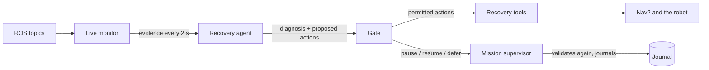
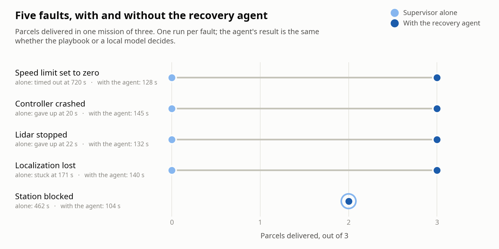
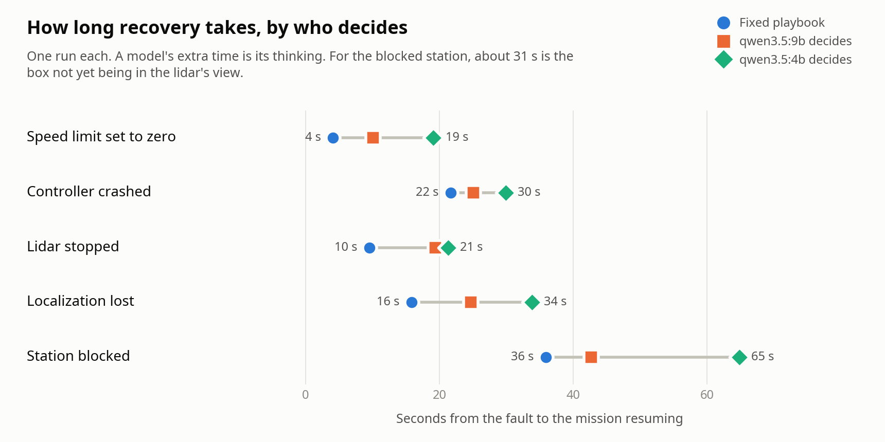

# Recovering a running mission

With `--recover`, a scenario run has a recovery agent attached. It watches the mission while it runs, and when
something goes wrong it pauses the mission, diagnoses the fault, acts, and resumes.

```bash
python3 -B -m warehouse_agent scenario scenarios/bad_parameter.json --recover rules        # fixed playbook
python3 -B -m warehouse_agent scenario scenarios/bad_parameter.json --recover qwen3.5:9b   # local model decides
```

## How it works



1. **Live monitor** (`warehouse_agent.monitor`). Builds the same evidence a finished recording gives, from the
   topics, and writes it every two seconds, together with the supervisor's own published status.
2. **Trigger.** The agent acts when the supervisor is holding after a failed goal, or when a check reports
   something wrong now: a dead or silent process, scans that stopped, a parameter that changed, a jump in the
   pose estimate, an obstacle on a stopping pose a parcel still has to reach, or a robot standing still under an
   active goal.
3. **Pause, then diagnose.** The mission is paused through the supervisor before anything is touched. Diagnosis
   is the same as for a recording ([diagnosis](diagnosis.md)), restricted to what has happened since the last
   recovery.
4. **Decide.** The fixed playbook maps the diagnosis to actions; with a model, the model chooses from the same
   list of typed actions and must answer in a fixed JSON shape.
5. **Gate.** Every proposed action is checked before it runs, whoever proposed it (table below).
6. **Act and resume.** Permitted actions run one at a time; then the mission resumes and the agent treats
   everything up to that moment as dealt with.

## Actions and what the gate requires

| Action | What it does | Permitted only if |
| --- | --- | --- |
| `restore_parameter` | Sets a parameter back to its value in the deployed Nav2 configuration | That node's parameter was seen to change during this mission |
| `restart_process` | Starts a Nav2 server, or the lidar driver, again with its original command line, then brings its lifecycle manager's group back up | The process was started by this run, and was seen dead, silent, or (lidar) to have stopped sending scans |
| `relocalize` | Re-applies the map-to-odometry correction from before a jump, combined with current odometry | A jump of at least 1 m or 0.5 rad in the pose estimate was observed |
| `clear_costmaps` | Clears the global and local costmaps | Always (the mission is held) |
| `defer_parcel` | Gives up on a parcel for now; the supervisor validates the command again | The parcel is active and not yet delivered |
| `escalate` | Records a request for a person | Always; nothing on the robot changes |

No action takes a free-form value. The value a parameter is restored to comes from the configuration file, the
pose from the evidence and odometry, the command line from the process table recorded at start-up. A model can
choose which action and which target; it cannot choose a number.

## What changed in the supervisor

Recovery needed three additions, all off unless asked for and all covered by the independent checker:

- **Fault hold** (`--on-fault hold`). After a failed goal the supervisor records the retry it owes and then holds
  instead of retrying at once. The hold ends on `resume`, or by itself after `--fault-hold-seconds` (90 by
  default), after which the normal retry-then-defer policy continues. A mission can therefore never wait forever
  on an agent that does not answer.
- **Direct commands `defer` and `retry`.** `defer` gives up on active parcels; `retry` takes deferred parcels up
  again with fresh attempts. Both are refused when they do not fit the mission state, and every refusal is
  journaled as `command_rejected`.
- **Command service** (`--recovery`). `warehouse/command` (`warehouse_interfaces/srv/OperatorCommand`) accepts
  pause, resume, status, defer and retry.

The language model that interprets operator requests can never defer or retry a parcel: those two operations are
accepted only from the direct channel, and the checker flags a journal in which a model request applied one
(`RECOVERY_NOT_DIRECT`).

New checker rules: a fault hold must directly follow the recorded retry of that stop
(`FAULT_HOLD_WITHOUT_FAILURE`); nothing may be dispatched while it is in force (`DISPATCH_WHILE_PAUSED`); an
expiry needs a fault hold in force (`EXPIRY_WITHOUT_FAULT_HOLD`); `defer` and `retry` are checked against parcel
state (`ILLEGAL_DEFER`, `ILLEGAL_RETRY`).

## Results

<picture>
  <source media="(prefers-color-scheme: dark)" srcset="figures/recovery-delivered-dark.png">
  
</picture>

One run per cell, on 10 November 2026 (RTX 4070, Ubuntu 24.04), all with the same code. The baseline is the
supervisor alone ([scenarios](scenarios.md)); a mission with no fault takes 123 s. Each cell is parcels delivered
and mission time; the second table is the time from the fault being in place to the mission resuming.

| Fault | Supervisor alone | Playbook | qwen3.5:9b decides | qwen3.5:4b decides |
| --- | --- | --- | --- | --- |
| `bad_parameter` | 0 of 3, timeout at 720 s | [3 of 3, 127.8 s](evidence/recovery/rules/bad_parameter/result.json) | [3 of 3, 134.2 s](evidence/recovery/qwen3_5_9b/bad_parameter/result.json) | [3 of 3, 142.5 s](evidence/recovery/qwen3_5_4b/bad_parameter/result.json) |
| `controller_crash` | 0 of 3, abandoned at 20 s | [3 of 3, 144.6 s](evidence/recovery/rules/controller_crash/result.json) | [3 of 3, 147.2 s](evidence/recovery/qwen3_5_9b/controller_crash/result.json) | [3 of 3, 152.3 s](evidence/recovery/qwen3_5_4b/controller_crash/result.json) |
| `lidar_dropout` | 0 of 3, abandoned at 22 s | [3 of 3, 132.3 s](evidence/recovery/rules/lidar_dropout/result.json) | [3 of 3, 142.4 s](evidence/recovery/qwen3_5_9b/lidar_dropout/result.json) | [3 of 3, 143.9 s](evidence/recovery/qwen3_5_4b/lidar_dropout/result.json) |
| `localization_lost` | 0 of 3, held at 171 s | [3 of 3, 139.7 s](evidence/recovery/rules/localization_lost/result.json) | [3 of 3, 148.7 s](evidence/recovery/qwen3_5_9b/localization_lost/result.json) | [3 of 3, 157.9 s](evidence/recovery/qwen3_5_4b/localization_lost/result.json) |
| `blocked_station` | 2 of 3, 462 s | [2 of 3, 103.6 s](evidence/recovery/rules/blocked_station/result.json) | [2 of 3, 110.3 s](evidence/recovery/qwen3_5_9b/blocked_station/result.json) | [2 of 3, 141.9 s](evidence/recovery/qwen3_5_4b/blocked_station/result.json) |

| Fault | Actions carried out | Playbook: fault to resume | qwen3.5:9b | qwen3.5:4b |
| --- | --- | --- | --- | --- |
| `bad_parameter` | restore the parameter | 4.1 s | 10.1 s | 19.1 s |
| `controller_crash` | restart the controller (and its lifecycle manager) | 21.7 s | 25.1 s | 29.9 s |
| `lidar_dropout` | restart the lidar driver | 9.5 s | 19.4 s | 21.3 s |
| `localization_lost` | relocalize, clear costmaps | 15.8 s | 24.7 s | 33.8 s |
| `blocked_station` | defer P2, escalate | 35.9 s | 42.7 s | 64.8 s (second look) |

<picture>
  <source media="(prefers-color-scheme: dark)" srcset="figures/recovery-time-dark.png">
  
</picture>

All fifteen journals pass `warehouse_agent verify` with 0 violations. In these fifteen runs every proposed action
was permitted and none failed.

How to read this:

- **Four of the five faults are fully recovered**, at a cost of 5 to 35 s over a fault-free mission. The fifth
  cannot be: the robot cannot move the box, so the right outcome is to give up on that parcel at once, deliver
  the other two and tell a person. That takes 104 s instead of the 462 s the supervisor alone spends trying.
- **For `blocked_station`, 31 of the seconds before resuming are the box not being visible yet.** It is placed
  out of the lidar's sight and seen about half a minute later. The playbook has acted 5 s after seeing it, the
  9B model 11 s after.
- **The model adds time and, on these faults, nothing else.** With one clean fault per run the playbook is as
  good as either model. On the four recoverable faults it resumes 3 to 10 s sooner than the 9B model and 8 to
  18 s sooner than the 4B model; the difference is the model's thinking time.
- **The 4B model needed two looks at the blocked station.** Its first diagnosis was `no_fault`: it read a phrase
  in the mission report meant for finished recordings ("still running when the recording ended") as the reason
  the goal had not finished. It got it right on the next look, 24 s later. The phrase has since been corrected
  for live missions; that run was not repeated.

### The first attempt with a model, and what it changed

The first time the 9B model made the decisions ([evidence](evidence/recovery/qwen3_5_9b-first-attempt/)), it did worse than
the playbook. Its diagnosis was right in all five runs and its first action was the right fix each time, but:

| Fault | First attempt | Why |
| --- | --- | --- |
| `bad_parameter` | 2 of 3 | After restoring the parameter it also deferred a healthy parcel, and escalated about an obstacle that did not exist |
| `controller_crash` | 0 of 3 | The restart came too long after the crash and failed (below); it also deferred a healthy parcel |
| `lidar_dropout` | 2 of 3, one stranded onboard | Restarted the lidar correctly, then deferred a healthy parcel; the gate refused its restart of the healthy controller and a relocalize with no pose jump |
| `localization_lost` | 3 of 3 | Correct |
| `blocked_station` | 2 of 3 | Correct |

Across those five runs the gate refused 6 of 30 proposed actions, all of them rightly. What it let through was
the problem, and three things changed because of it:

- **Deferral needs evidence too.** `defer_parcel` had only been checked for being a deferrable parcel. It now
  requires an obstacle seen on the stopping pose that parcel has to reach next, like every other action requires
  its own evidence.
- **A late restart has to replace the lifecycle manager.** Nav2's lifecycle manager notices a dead server after
  4 s and resets the nodes it manages. If the server is not back by then, the manager blocks on the dead
  server's reset and never returns: it answers no service calls and ignores an interrupt. The playbook had been
  quick enough to restart the server first; a model that thinks for ten seconds or more is not. `restart_process` now detects
  an unresponsive manager, takes every server it managed back to unconfigured, and starts a fresh manager.
- **The model no longer chooses whether to resume**, and is told to choose the fewest actions that remove the
  diagnosed cause. The mission always resumes after the actions; if a fix failed, it stays held and the fix is
  tried again, up to three times.

Two faults in the tooling itself also surfaced while building this, both of the same kind, a tool reporting
success it had not checked: a relocalization whose pose message never reached the localizer, and a resume
issued before Nav2 had seen any scans from the restarted lidar. Pose-setting now confirms from the transforms
that the estimate moved, and the agent waits for scans and heartbeats to be healthy before resuming.

## Limitations

- **One run per cell.** The times are examples, not averages, and one success is not a recovery rate.
- **These are the five faults the tools and the playbook were written for.** Nothing here was held out. The
  playbook matching the models is expected on such a set and says nothing about faults or combinations that no
  rule covers, which is where a model would have to earn its place.
- **Recovery is not verified against ground truth.** After relocalizing, the supervisor's arrival checks still
  use the pose estimate, so "delivered" means delivered according to localization. Comparing with Gazebo's true
  pose is not done yet.
- **The lidar fault is simulated by a relay**, and restarting the "driver" is restarting that relay. A real dead
  sensor may not come back.
- **The gate checks that an action is justified, not that it is wise.** It would permit restoring a parameter
  someone changed on purpose.
- Escalation only records a message; nobody is told.
- The agent only ever sees one mission, one robot and one fault at a time.
